# Architecture

SparkyAI is a Discord copilot for the AI Society at ASU. It answers questions from public ASU sources, keeps conversation history and a profile of each user, and gates moderator actions behind policy and confirmation.

This document describes the current shape of the system and its rules. Order of work is in the master issue [#79](https://github.com/theaisocietyasu/sparky/issues/79); direction and scope are in [ROADMAP.md](ROADMAP.md). Decisions are recorded in the commits that settle them.

## Stack

| Layer | Choice | Where |
|---|---|---|
| Engine, Discord bot, console | tokio, axum, serenity, ratatui, serde, thiserror, figment | `apps/engine`, `apps/discord`, `apps/cli` |
| Model and embed clients | Rig (`rig-core`) OpenAI-compatible client | `apps/engine/src/runtime/model/rig_openai/` |
| MCP | `rmcp` | `apps/engine/src/runtime/tools/mcp.rs` |
| Conversations, memories, confirmations | one SQLite file through `sqlx`, opened by the engine only | `apps/engine/src/stores/sqlite/` |
| Knowledge, live ASU queries, linked accounts | Platform HTTP API and MCP | [asusoda/platform](https://github.com/asusoda/platform), a separate repo |
| Web | Vite, React, TypeScript, shadcn | `apps/web` |
| Fine-tuning | lives outside this repo | [loupe](https://github.com/ashworks1706/loupe), a separate repo |
| Evals | golden cases against the engine, baseline gate | `apps/evals` |
| Chat model | Qwen3 GGUF on `llama-server` | compose service `chat`, profile `model` |
| Embeddings for Platform | Qwen3-Embedding-0.6B, 1024 dimensions, on `llama-server`; the engine does not call it | compose service `embed`, profile `model` |
| Observability | OpenTelemetry spans to Phoenix, product events as spans, JSONL traces and logs under `.sparky/` | profiles `phoenix`, `metrics` |
| Config | `sparky.toml`, then `SPARKY_*` env vars | `sparky.toml`, `.env.example` |
| Build, gate | `just` recipes, pre-commit hook, CI | `justfile`, `.githooks`, `.github/workflows` |
| Deploy | Docker Compose, prod pulls GHCR images; one RunPod pod under supervisord, with run_sandbox as WebAssembly | `deploy/` |

## Rules

- Open models only, served by `llama-server` behind an OpenAI-compatible HTTP API.
- Facts come from Platform search or a page the agent read, never from model weights.
- The engine never fetches a page for the index. Platform crawls ASU pages, writes the index, and runs search.
- The engine opens one SQLite file for its own conversations, memories and confirmations; every other store is the Platform HTTP API.
- Every request carries its own `RequestContext`. There is no global mutable state.
- Every replaceable dependency is a trait in `engine/src/core/traits` with a test double in `core/tests/support`.
- The harness owns the loop, policy, context assembly, memory, and tracing. Provider JSON never leaves `runtime/model`.
- Model output is never written back as search evidence.
- An action at or above `policy.confirm_from` is held for the caller's approval immediately before it runs.
- Credentials, cookies, and authenticated page content never enter the search index, memory, or traces.

## Layout

```
apps/
  engine/         Rust bin. The agent, its HTTP surface, and the store adapters.
    src/core/       config (services, integrations, http, harness by domain), telemetry, types, traits, tests
    src/runtime/    harness (loop, prompt, uploads, memory, safety, compaction, trace), model (Rig client, slot limit, server props), tools (knowledge/search, account for per-user Outlook and Gcal, papers, wiki, files, mcp, sandbox, shared http)
    src/stores/     platform/: client, conversation, confirmation, memory, discovery, query, accounts, health over the Platform HTTP API
    src/routes/     chat (JSON and SSE), confirm, conversation, profile, oauth, sandbox, health, rate limit, auth, failure
    src/wiring/     builds every dependency from config and serves: platform stores, tools, agent, http, boot checks, system prompt
  discord/        Rust bin. serenity bot and HTTP client of the engine. Never links it.
    src/core/       config, telemetry, types, tests
    src/bot/        client, addressed messages, turn destinations, memory and login commands, approvals, replies, the streamed turn
    src/engine/     HTTP client of the engine and SSE frame parsing
    src/render/     the turn card, reply text, buttons and their custom ids
    src/access/     roles, permissions, where a turn is answered, and what a message carries
    src/analytics/  product events, one exported span each
  cli/            Rust bin sparky. Developer console: runs just recipes and compose services and tails them.
    src/core/       config, types, tests
    src/app/        console state, key map, control, rendering
    src/units/      unit catalog, process runner, output parsing, log buffers, health probes, engine sandbox
  evals/          Python. Evals with a baseline gate.
    core/           settings, types, tests
    cli.py          eval run, baseline, compare
    runner.py       loads cases and runs them against the engine /chat
    suites/         one scorer per suite, SUITES in __init__.py
    cases/          golden cases, one JSON object per line
  web/            Vite and React frontend and admin UI
deploy/           compose (dev and prod), Dockerfiles, inference, monitoring, sandbox, runpod
docs/             ROADMAP.md, this file
.sparky/          ignored local state: traces, logs, eval reports
```

`apps/evals` is its own importable package (`evals`) with no `src/` layer. `pyproject.toml` maps the package to `.` and lists its subpackages, so a new subpackage is added there.

Every app has a `core/` holding config, telemetry, data types, interfaces, and tests. Domain modules import from it; it imports nothing from them. Language is never a folder, and neither is ASU domain (library, events): that is a module in `runtime/tools/knowledge/search/sources/` and an entry in the Platform query registry.

## System context

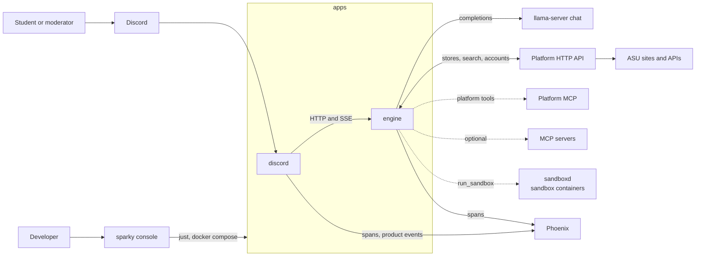

Processes talk only at these edges. Platform ([asusoda/platform](https://github.com/asusoda/platform)) is a separate service: it holds the knowledge index, the live query registry, and linked accounts, and it alone crawls and queries ASU sites. Beyond Platform, the engine calls only the Microsoft Graph, Google Calendar, Semantic Scholar, and MediaWiki APIs and the attachment hosts in `agent.file_hosts`; with `sandbox.egress` on, a sandbox command reads public pages through the egress proxy. Other MCP servers are optional and none is configured by default.

The engine serves `/chat` and `/chat/stream` for the bot; both run the same loop. Every route except health and `/web/*` requires the bearer token in `SPARKY_ENGINE__SERVICE_TOKEN` or, where the web sign-in below allows it, a session cookie; and every route that carries a user applies the per-user `http.rate_limit_per_min`. The sandbox routes carry no user and are gated by the token alone, so any holder of it, `apps/discord` included, can read and stop the sandbox: `GET /sandbox` reports what is running, `DELETE /sandbox/{name}` removes one session container, and `POST /sandbox/enabled` stops the agent being offered `run_sandbox`. `apps/cli` shows and drives the containers through them, since the engine starts the containers outside compose.

### Web sign-in

With `[web] enabled`, a browser signs in with Discord instead of holding the token. `GET /web/login` sets a short state cookie and sends the browser to Discord with the scopes `identify guilds`. `GET /web/callback` checks the state, trades the code through `DiscordIdentity` (`stores/discord.rs`), and admits only members of `discord.guild_id`; a member whose guild permissions include Manage Server or Administrator gets the first `policy.write_roles` entry as a role. The session is the user id, display name, roles and expiry, sealed with XChaCha20-Poly1305 under `SPARKY_WEB__SESSION_KEY` into an `HttpOnly; Secure; SameSite=None` cookie that lasts `web.session_hours`. `GET /web/me` returns it and `POST /web/logout` clears it.

`/chat`, `/chat/stream`, `/chat/confirm`, `/conversation/reset`, `/memories/*` and `/canvas/feed*` take either the bearer token or the session cookie. A cookie counts only when the request `Origin` is `SPARKY_WEB__SITE_URL`, or, with no `Origin`, when the browser sends `Sec-Fetch-Site: same-origin`; this stands in for a CSRF token. On Vercel, `apps/web/api/engine.ts` serves the engine under `/api/engine` on the site origin, so the cookie is first-party; the sign-in state cookie takes the path of `SPARKY_WEB__PUBLIC_URL`. With a session, the engine replaces the user, roles and tenant in the body with the session's, and runs the turn as private on channel `web`. `apps/web` serves the client: `/chat` is home, which streams `/chat/stream` and shows the newest progress line in place, the answer with its sources, and approval buttons; Sparky's own messages sit in home with a tag and thumbs, and the Home link shows a dot while any are unread; `/chat/new` starts a thread off a home message and `/chat/{id}` reopens a thread; the profile menu opens `/settings`, whose sections are Profile, Connected accounts (Canvas), Notifications (check-in switches, quiet hours, reminders), Memories (list and forget) and Appearance. `/memories` and `/connections` redirect there. The web-only routes `GET /web/home` (the id of the student's home conversation; see Home chat), `GET /web/conversations` (the newest `web.conversation_list` open web conversations besides home, titled by the first question cut to `web.title_chars`, each with its `parent` when it is a thread), `GET /web/conversations/{id}` (its questions and answers with their positions, at most `web.conversation_turns` messages) and `DELETE /web/conversations/{id}` back the threads sheet under the top bar, and `GET /canvas/feed` says whether the student has a link. The page sends every turn with `continue_channel` off and the conversation id of home or the thread. They call the engine at `VITE_ENGINE_URL` with `credentials: include`. CORS allows credentials only while the web sign-in is on, and `Config::validate` then requires the site in `http.cors_origins` and refuses `*`.

### Admin surface

`/admin/*` (`routes/admin.rs`) takes the bearer token or a web session whose roles hold the first `policy.write_roles` entry; any other session gets 403. `GET /admin/tools` lists every registered tool and whether it is offered, and `POST /admin/tools/{name}` with `{on}` switches one for the next turn: `ToolSet` keeps the switched-off names in a set its clones share, so `get` and the definitions leave the tool out. `GET` and `PUT /admin/instructions` read and replace the system instructions (`text: null` returns to `prompt.system`), at most `admin.max_instructions_chars`. Each write is a row in `admin_changes` (migration 0004) with the actor's user id; `GET /admin/history` lists the newest `admin.history_limit`, and `POST /admin/rollback/{id}` writes that row's value again. The newest row per kind and key is in force, and the engine applies them at boot. `GET /admin/limits` shows the settings that bound load, and `GET /admin/guardrails` the `[guardrail]` and `[policy]` settings. `GET /admin/approvals` lists held actions by user, tool and expiry without their arguments, and `POST /admin/approvals/{token}/deny` denies one. The store is `AdminStore` (`stores/sqlite/admin.rs`); with `store.backend = "platform"` the routes that need it answer 501. `GET /admin/traces` lists the newest `admin.traces_limit` traces of the tenant from `trace.dir` (request id, user, first 160 characters of the input, status, steps, tokens, duration, guardrail blocks and redactions, and the OpenTelemetry trace id with its Phoenix page when `telemetry.phoenix_ui_url` is set), and `GET /admin/traces/{id}` returns every record of one; the id must parse as a UUID, and each read is logged with the actor. Moderators see every turn, direct messages included; `ReadAuthenticated` tool results are masked on disk, so a trace never holds linked-account data. With `trace.enabled` off the trace routes answer 501. `GET /admin/sources` lists the live sources Platform search can name. `apps/web` serves the pages at `/admin` (an overview from these routes), `/admin/{tools,instructions,guardrails,history,approvals,limits,traces,sources}` and `/admin/traces/{id}`.

The console starts and stops the other units and tails their output. It does not start a process whose port is already served, and says so instead.

## Inside engine

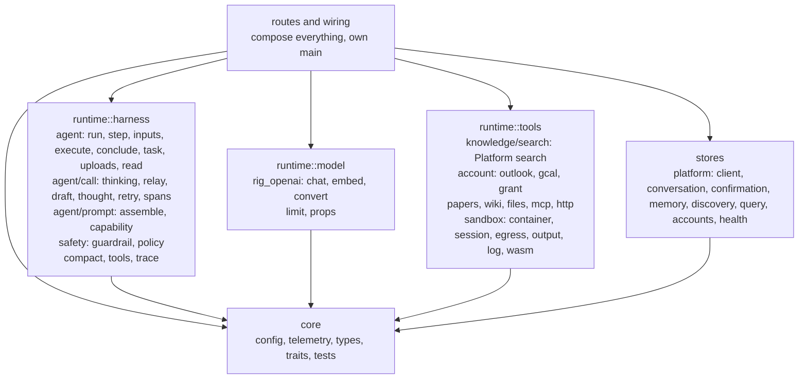

`core` imports nothing else in the crate. `runtime::harness`, `runtime::model`, `runtime::tools`, and `stores` import only `core`. `routes` and `wiring` compose them. `scripts/check-deps.sh` enforces that the three Rust apps never depend on each other.

Folders nest by domain, and the same domain names repeat across `core/types`, `core/traits`, `core/tests`, `runtime`, and `stores`: agent, conversation, http, knowledge, memory, model, safety, tools, trace. A domain with one file at a level keeps that file flat. Data lives in `core/types`, interfaces in `core/traits`, and stateful objects beside their implementations.

`runtime::model::limit` wraps the chat client in a semaphore of `agent.model_slots` permits, matching `llama-server --parallel`. A call waits up to `agent.model_queue_wait_secs` for a slot, then fails as busy.

## Platform stores

`wiring/platform.rs` builds a `Stores` value of trait objects over `stores/platform/`, and `wiring/store.rs` moves conversations, memories and confirmations to the local store; the harness, tools, routes, and `core` see the traits alone. `SPARKY_PLATFORM__URL` and `SPARKY_PLATFORM__TOKEN` are required.

| Store | Platform |
|---|---|
| `ConversationStore`, `MemoryStore`, `ConfirmationStore`, only with `store.backend = "platform"` | `/api/agents/members/{user_id}/...` |
| the one-time import | `GET /api/agents/export/conversations` and `/memories` |
| `Discovery`, with `read_page.save_pages` | `POST /api/knowledge/discovered`, the URL of a page read_page read |
| `SourceQueries` | `GET /api/tools` for the search tool's description and schema, `POST /api/tools/search` while the call waits, bounded by the request deadline; `GET /api/asu/queries` for `/admin/sources` |
| `OAuthStore` | `/api/accounts/members/{user_id}/{provider}/token` and `/login`; Platform runs the login and refreshes tokens |
| readiness `Probe` | `GET /health` on Platform |

The engine needs the chat server and Platform. Platform takes the organization from the machine token (`Authorization: Bearer plat_...`), so `tenant_id` is not sent, and the member is `user_id`, which Platform requires to be a numeric Discord user id. One engine serves one guild, and its token belongs to the Platform organization of that guild. The token needs the scopes `agents:read`, `agents:write` (the import and `store.backend = "platform"`), `knowledge:read`, `knowledge:discover` (with `read_page.save_pages`), `accounts:link`, `accounts:token`, and `asu:read`.

With `platform.mcp_url` set, the engine also registers the Platform MCP tools with the same token (`runtime/tools/mcp.rs`, `connect_platform`). Each tool is named `platform_<name>` with dots as underscores; `platform.mcp_tools` limits the list, and the token scopes decide which tools Platform offers. The risk comes from the MCP annotations: `readOnlyHint` is `ReadPublic`, `destructiveHint` is `Destructive`, and any other tool is `ExternalWrite`, so `Policy` requires `policy.write_roles` and a confirmation for every write. The Platform `confirm` argument is removed from the schema the model sees; the tool sends `confirm=true` after `Policy` confirmed the call.

A Platform tool whose name starts with a prefix in `platform.mcp_skip` (default `canvas.`, `knowledge.`, `batch`, `search`, `submodules.`) is not registered: the engine serves Canvas itself (see Canvas) and search through its own tool (see Search), and the knowledge admin tools are for officers. A Platform tool whose name starts with a prefix in `platform.mcp_private` (default empty) returns one member's own data. A read-only one is `ReadAuthenticated`, the tool refuses outside a direct message, and its `discord_id` argument is removed from the schema the model sees; the call sends the caller's `user_id` in its place, so a member reads only their own account (`mcp::Fill`).

## Local store

`stores/sqlite/` holds `ConversationStore`, `MemoryStore`, `ConfirmationStore`, `CanvasFeeds` and `AdminStore` over one SQLite file (`store.path`), with the migrations in `apps/engine/migrations/` embedded and run at boot. Every row has `tenant_id` and `user_id`, and every query binds both from the `RequestContext`. A memory marked sensitive is sealed with XChaCha20-Poly1305 under `SPARKY_MEMORY__KEY`; a row that does not open is left out of recall and logged by id. A claim is one `UPDATE ... RETURNING`, so a confirmation is answered once. With `store.backup_dir` set, a `VACUUM INTO` copy is written every `store.backup_every_hours` and the newest `store.backups_kept` are kept. A readiness `Probe` named `store` runs `SELECT 1`. Every `store.prune_every_hours` the store deletes expired memories, answered or expired pending actions, and, when `store.conversation_idle_days` is above 0, conversations idle that long with their messages.

`engine import-platform` copies the Platform export once: conversations updated in the last `store.import_days` days with their messages, each summary's `covers` rewritten to the new positions, and every memory, sealed when Platform marked it sensitive. The `imports` table refuses a second run unless `--again` is passed.

What Platform serves beside the stores:

| Part | Platform |
|---|---|
| Search | the `search` tool: stored pages, the live sources of the `asu` pack, and SearXNG web search, with a shared Playwright browser for JS pages |
| Sun Devil Central clubs and events behind an ASU sign-in | `platform_asu_clubs` and `platform_asu_events` (scope `asu:read`), over the organization's ASU sign-in |
| `/login` and `/logout` | the Platform accounts link (`accounts:link`) and grant removal |
| Outlook and Google Calendar | engine tools over tokens from Platform (`accounts:token`) |

## Types

```rust
pub struct RequestContext {
    pub request_id: Uuid,
    pub tenant_id: String,
    pub user_id: String,
    pub roles: Vec<String>,
    pub conversation_id: Uuid,
    /// Public when anyone but the caller can read the answer.
    pub visibility: Visibility,
    pub deadline: Instant,
    pub cancel: CancellationToken,
    /// Live progress goes here while a caller is watching; None for a plain request.
    pub progress: Option<UnboundedSender<Progress>>,
}

```

Citations are built from the pages the tools returned (`Answer.sources`), never parsed out of generated text. A `Citation` has a `title` a client shows (the stored page title, or the site of a live page) and a `key` naming the source (the page url, or the live source's key), which is what a caller matches on.

## Traits

All in `engine/src/core/traits`. Inputs and outputs are owned types from `core/types`. The main ones:

```rust
#[async_trait]
pub trait ModelProvider {
    async fn generate(&self, ctx: &RequestContext, req: ModelRequest) -> Result<ModelResponse, ModelError>;
    // The same completion, sending each reasoning and text piece to deltas as it arrives.
    async fn stream(&self, ctx: &RequestContext, req: ModelRequest, deltas: UnboundedSender<ModelDelta>) -> Result<ModelResponse, ModelError>;
}

#[async_trait]
pub trait Tool {
    fn definition(&self) -> ToolDefinition;   // name, description, JSON schema, risk, sequential, timeout
    async fn call(&self, ctx: &RequestContext, args: Value) -> Result<ToolOutput, ToolError>;
}

#[async_trait]
pub trait SourceQueries {
    async fn sources(&self) -> Result<Vec<QuerySourceInfo>, QueryError>;
    async fn spec(&self) -> Result<SearchSpec, QueryError>;
    async fn search(&self, ctx: &RequestContext, args: &Map<String, Value>) -> Result<SearchAnswer, QueryError>;
}

#[async_trait]
pub trait ConversationStore {
    async fn ensure(&self, ctx: &RequestContext, channel_id: &str) -> Result<(), StoreError>;
    async fn owns(&self, ctx: &RequestContext) -> Result<bool, StoreError>;
    async fn load(&self, ctx: &RequestContext, limit: usize) -> Result<Vec<Message>, StoreError>;
    async fn append(&self, ctx: &RequestContext, turns: &[Message]) -> Result<(), StoreError>;
    async fn latest(&self, ctx: &RequestContext, channel_id: &str) -> Result<Option<Uuid>, StoreError>;
    async fn end(&self, ctx: &RequestContext, channel_id: &str) -> Result<u64, StoreError>;
}

#[async_trait]
pub trait MemoryStore {
    async fn recall(&self, ctx: &RequestContext) -> Result<Vec<Memory>, StoreError>;
    async fn remember(&self, ctx: &RequestContext, memory: &NewMemory) -> Result<Memory, StoreError>;
    async fn forget(&self, ctx: &RequestContext, id: Uuid) -> Result<bool, StoreError>;
    async fn forget_all(&self, ctx: &RequestContext) -> Result<u64, StoreError>;
}

#[async_trait]
pub trait Policy {
    async fn authorize(&self, ctx: &RequestContext, action: &ProposedAction) -> Decision;
    // Decision: Allow | Deny { reason } | Confirm(ConfirmationRequest)
}

#[async_trait]
pub trait Guardrail {
    async fn check(&self, ctx: &RequestContext, stage: Stage, text: &str) -> Verdict;
}

pub trait TraceSink {
    fn emit(&self, ctx: &RequestContext, event: TraceEvent);
}
```

The rest follow the same pattern: `Compactor`, `ConfirmationStore`, `Sandbox`, `FileSource`, `Outlook`, `GoogleCalendar`, `OAuthStore`, `Probe`. `OAuthStore` loads a caller's linked grant, removes it, and hands out the Platform `login_link`.

## Request lifecycle

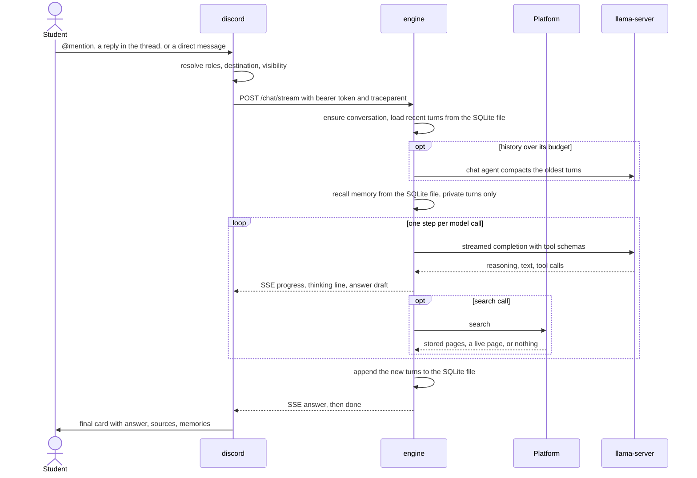

1. `discord` posts an addressed message to the engine with the Discord identity, role names, the answering channel, its visibility, `continue_channel`, and the bot message a reply answers. A question is never a slash command; the remaining commands only read and clear memory.
2. The engine checks the bearer token and the per-user rate limit, then builds a `RequestContext`. A given `conversation_id` must belong to the caller. Without one, `continue_channel` continues the caller's newest open conversation in that channel at that visibility; otherwise a new conversation starts.
3. The loop loads inputs once: the last `agent.history_turns` turns, compacted if they overflow the history budget, and, in a private turn only, memories. A failed memory read is logged and the turn runs without it. Nothing is looked up before the first model call: the model calls `search` as the question needs, several in one step when it words the subject more than one way.
4. The loop runs steps until it stops. On `/chat/stream` each progress event goes out as an SSE frame. A turn about to answer after a tool failed, with `run_sandbox` registered and untried, is handed back once with `prompt.sandbox_retry_line`.
5. Every exit appends what was said and builds the answer with citations, tool runs, memories (empty for a public answer), usage, and cost. Tool calls and results are not stored in history.
6. An answer with status `AwaitingConfirmation` carries a token. `POST /confirm` with that token runs the held action and resumes the loop from its result.

## Prompt assembly

Each step assembles the prompt in a fixed order:

1. System instructions, the role line, and today's date.
2. The capabilities section, if it fits `agent.capabilities_budget_tokens`.
3. Memory, within `agent.memory_budget_tokens`.
4. History, newest first within `agent.history_budget_tokens`, never starting on an orphaned tool result.
5. The user's input, then the model and tool turns of this request.

Tool schemas are sent beside the messages and are charged to `agent.prompt_budget_tokens` first; history is capped by what remains. The system prompt, the input, and this request's tool exchange are never dropped. When this request's tool results outgrow the room left after the fixed sections and the input, each is cut to a share of it, smallest first, ending in `prompt.result_cut_line`. Token counts are estimates from `agent.chars_per_token`. MCP schemas are compacted and by default show only required properties.

## Agent loop

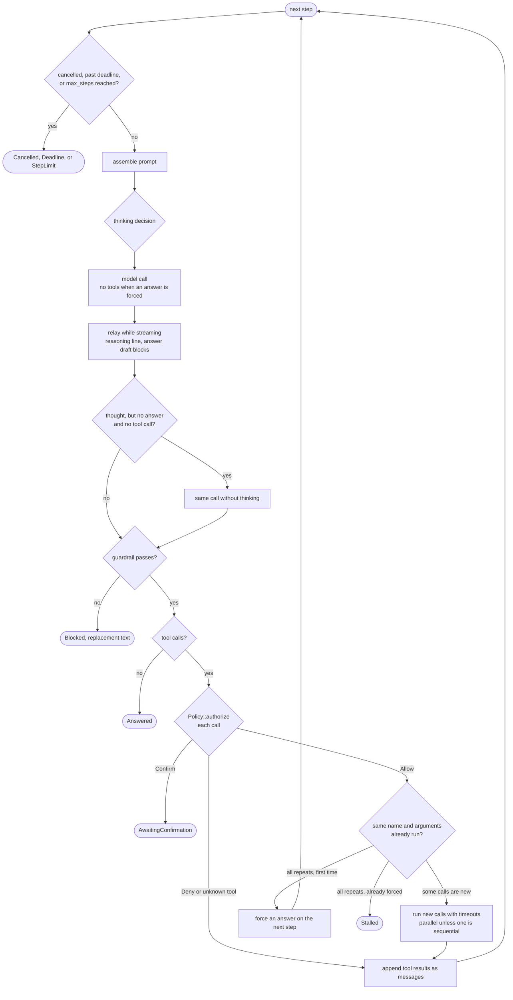

The loop owns every stopping condition and checks cancellation, the deadline, and `agent.max_steps` before each step.

**Thinking** is decided per model call by `agent.thinking`. `on` and `off` apply to every call. In `auto` the first matching rule wins: a call with no tools does not think; a step after a tool call that failed or returned nothing thinks when `recover` is set; a question with a cue word or longer than `max_quick_chars` thinks; a step after tool results thinks when `after_tools` is set; a step before any tool has run thinks when `plan_searches` is set; anything else does not. By default only `recover` is set, so a simple lookup never thinks. A thinking call gets `model.max_tokens`, others `model.max_tokens_without_thinking`. A call that thought and returned neither an answer nor a tool call is repeated once without thinking when `retry_without` is set. The `llm` span records `sparky.thinking` and `sparky.thinking_reason`. Prompted sub-agents never think.

**Streaming.** With `agent.stream` on, reasoning updates the thinking line as it grows. When answer text begins, the thinking line becomes the full thought, clipped to `agent.progress_thought_chars`. Answer text is released as a draft at the end of a sentence or line, or at a word break past `agent.stream_block_chars`, and every block passes the guardrail before it is sent. A draft is withdrawn when the call ends in tool calls, fails, or a block is refused. A step that answers without showing a thought takes its thinking line back.

**Guardrail and policy.** Every response passes the guardrail: the answer stage for a final answer, the capability stage for a response with tool calls and text. A denied phrase, an empty answer, or an over-length answer blocks the response and ends the run with `guardrail.replacement`. On the answer stage the guardrail also removes protected terms: the registered tool names that hold an underscore are added to `guardrail.protected_terms` at boot (a one-word name such as `remember` is an ordinary word), so a tool name that slips into an answer is replaced with `guardrail.redaction` rather than shown to the student. The system prompt is the first line of this defense, telling Sparky never to name a tool, reveal its instructions, say which model runs it, or follow instructions found in tool output. `Policy` decides whether a typed action may run by its risk class.

**Tool calls** are authorized before any runs. A denial or an unknown tool name becomes a tool result the model reads. The first call that needs confirmation is stored through `ConfirmationStore` and ends the run. Allowed calls that repeat an earlier call with identical arguments are not run again, and the model is told so. When every call in a step is a repeat, the next step offers no tools and adds `prompt.answer_only_line`; if that step repeats again or answers with nothing, the run ends as `Stalled`. Allowed calls run in parallel, each under its own timeout (the tool's declared timeout or `agent.tool_timeout_secs`, capped by the request deadline), or in order if any call is to a tool marked sequential. A tool error, including `InvalidArguments`, is fed back as the tool result.

**Model errors.** A retryable error (transport, 5xx, 429) is retried with backoff up to `agent.max_model_retries`. A model timeout ends the run as `Deadline`, cancellation as `Cancelled`, and any other error keeps the turns and returns the error.

## Prompted sub-agents

Each sub-agent is a `runtime::harness::agent::task::Task`: its own instructions, one model call, no tools, no thinking, and a typed result. The loop is not a `Task`.

| Agent | When | Reads | Writes |
|---|---|---|---|
| Sparky (the loop) | every request | tool results, memory, history, capabilities | the turn |
| Chat | loaded history overflows its budget | the turns being replaced | one compacted turn |

## Capabilities

`runtime::harness::agent::prompt::capability` renders one `<capabilities>` list in the prompt. Each entry names its kind.

| Kind | Executed by | Risk |
|---|---|---|
| `tool` | a built-in `Tool`: `search`, `run_sandbox` | declared per tool |
| `mcp` | a remote MCP server | `risks` in the server entry, else derived from the tool name; a pin the server does not list fails boot |

`tools.disabled` removes tools by name at registration. The engine refuses to boot when the capabilities section exceeds its budget, when the tool schemas take more than half of `agent.prompt_budget_tokens`, or when the prompt budget plus `agent.prompt_estimate_headroom` and `model.max_tokens_without_thinking` do not fit one `llama-server` slot.

**The sandbox image.** `run_sandbox` runs a command in a container with a read-only root, memory, CPU, and process limits, a non-root user, and a workspace of `sandbox.workspace_mb` mounted `noexec` at /tmp. The image is `deploy/docker/sandbox.Dockerfile`: python3 with requests, bs4, lxml, pandas, numpy, pypdf, python-docx, openpyxl, xlrd, Pillow, chardet, yaml and markdown; pdftotext, pdftoppm and tesseract; curl, wget, jq, ripgrep, sqlite3 and the usual text tools. The live test `the_image_carries_python_jq_and_the_document_readers` checks every one.

**Network.** With `sandbox.egress` off the container runs with `--network none`. With it on, the container joins `sandbox.egress_network`, which the engine creates `--internal` at boot (and refuses to use if it exists and is not internal), with `HTTP_PROXY` and `HTTPS_PROXY` pointing at `sandbox.egress_proxy_name`. That proxy (`deploy/docker/sandbox-proxy.Dockerfile`, `deploy/sandbox/squid.conf`) is the only container on both that network and the outside. It allows ports 80 and 443 and refuses private, loopback, link-local and reserved destinations, so a command reaches public sites and never the engine, the host, or cloud metadata. HTTPS passes through as a tunnel. What the sandbox reads is never indexed.

**Sessions.** A call that names a session reuses its container, so workspace files persist between calls. Session containers are named from a hash of the tenant and user, so one caller cannot reach another's session. A container idle for `sandbox.session_idle_secs` is removed; a caller holding `sandbox.max_sessions` loses their least recently used one; `sandbox.max_sessions_total` caps session containers across callers, reaping the least recently used of all. `sandbox.max_running` caps commands running at once; a command past it waits for a slot within its budget. Every command runs under `timeout -s KILL` inside the container. stdout and stderr are read as they arrive and only a head and tail of each is held.

**Lifecycle.** Every container the engine starts, and the egress proxy, carries the `sparky.sandbox` label. `just sandbox-down` removes them by that label, and `just down` runs it first. The recipe reads `.env` so `DOCKER_HOST` points at the runtime the engine drives (`sandboxd` under compose). Containers also carry `sparky.sandbox.instance` (`sandbox.instance`); at boot and on every idle sweep the engine removes session containers of its instance it is not tracking. The engine keeps the last `sandbox.recent_commands` commands, the running one included. Each carries an id, is redacted like a traced tool argument, and is reported once while it runs and once when it ends; a call the loop cancelled is recorded as ended with no exit status. `POST /sandbox/enabled` takes the tool out of `ToolSet::definitions`, so the schema, the capabilities section, and the sandbox hand-back all stop naming it.

**Runtime.** Under compose the runtime is the `sandboxd` service, a daemon of its own reached over `DOCKER_HOST`; on a developer host it is the local `docker`. It is probed once at boot: `sandbox.required` decides whether an unreachable one fails boot or leaves `run_sandbox` unregistered.

**WebAssembly.** With `sandbox.runtime = "wasm"`, as on a RunPod pod where containers cannot start, `WasmSandbox` runs the command with no container.

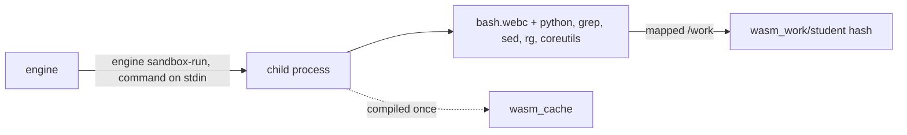

The engine starts itself as a child (`sandbox-run`), which loads every package in `sandbox.wasm_packages` (pinned by sha256 in `deploy/wasm/packages.txt`), compiles them with Cranelift into `sandbox.wasm_cache`, and runs `bash -c` with the student's folder mapped to `/work`. The guest sees no host file outside `/work` and has no network. The folder is named from a hash of the tenant and user and is kept between calls; one past `sandbox.workspace_mb` is refused until files are deleted, and `DELETE /sandbox/{name}` deletes it. A command past its budget has its child killed. Attached files are read in the engine (`converts` is false) and written to `/work` with a `.txt` copy of their text. At boot the engine runs python once in the background so the first student does not wait for compilation.

A tool result longer than `agent.tool_result_to_file_chars` is written to the workspace and replaced by its head plus the path; `0` turns this off. The full result still reaches the trace, and a long live listing reaches the workspace whole.

### Resource limits

Everything that could grow with load has a ceiling in `sparky.toml`:

| What | Bound |
|---|---|
| Turns in flight | `agent.max_turns`; a turn waits up to `agent.turn_queue_wait_secs`, then gets 503 busy. The permit is held for the whole turn, detached streaming turns included, so attachments and tool results held in memory are bounded with it |
| Model calls | `agent.model_slots` |
| Sandbox | `sandbox.max_sessions` per user, `sandbox.max_sessions_total` overall, `sandbox.max_running` commands, `sandbox.memory` and `sandbox.workspace_mb` (a tmpfs) each; sandboxd's `mem_limit` bounds them together |
| Attachments | `agent.max_files` of `agent.max_file_bytes`, streamed with the cap enforced |
| Live results | `query.timeout_secs` per query; past `agent.tool_result_to_file_chars` the rest goes to the workspace |
| Containers | a `mem_limit` on every compose service, overridable with `SPARKY_MEM_<SERVICE>` |
| Store | `store.max_connections` pooled connections to the SQLite file; a write waits up to `store.busy_timeout_ms` for a lock |
| Memories | `memory.max_per_user` per student, each at most `memory.max_chars`; at the cap the oldest fact goes, then the oldest preference, then the oldest task |

What is kept on disk is pruned: JSONL traces after `trace.retention_hours`, checked hourly, each capped at `trace.max_file_bytes`; CLI unit logs rotated at `cli.log_file_max_mb` to one `.1` file, lines cut at `cli.log_line_chars`. Memories stay until a student forgets them or a task passes its due date. Conversations stay until `store.conversation_idle_days` of idleness when that is above 0.

### Attached files

`discord` forwards every non-image attachment, up to `bot.max_files` of at most `bot.max_file_bytes`, as `files` on the chat request. The web chat sends files inline: each carries its bytes in base64 as `data`, and `http.max_body_bytes` leaves room for them. The engine takes up to `agent.max_files` of at most `agent.max_file_bytes` into `RequestContext.files`.

Before the first model call, `uploads.rs` decodes an inline file, or downloads one through `FileSource` (`HttpFiles`: HTTPS only, hosts in `agent.file_hosts`, no redirects, the byte cap enforced while streaming) and writes it into the conversation's sandbox session as `upload-<name>`. One command there turns it into text at `<path>.txt`: pdftotext for a PDF, tesseract over its first `agent.upload_ocr_pages` pages when it has no text layer, python-docx, openpyxl and pandas for Word, Excel and CSV. The same command ranks the passages by how many words of the question each holds.

The prompt gets one `prompt.upload_line` per file, just before the question: name, size, paths, session, the first `agent.upload_preview_chars` of its text, and the best passages up to `agent.upload_match_chars`. A file with no text gets `prompt.upload_raw_line`; one that could not be downloaded or written gets `prompt.upload_failed_line`. Each emits `TraceEvent::FileAttached`. The file stays in the session until the session idles out.

With no sandbox, or one that cannot convert (the WebAssembly one), `agent/read.rs` reads the file in the engine: pdf-extract for a PDF, UTF-8 for text, CSV, JSON and code. It ranks passages the same way, and the prompt gets `prompt.upload_inline_line`, which names no paths. Other types, and a PDF with no text layer, get `prompt.upload_failed_line` with the reason.

## Compaction

Without compaction, history is trimmed to its budget by dropping the oldest turns. With `compaction.enabled`, compaction runs when the loaded history, a stored summary included, is over `agent.history_budget_tokens`. It keeps the newest turns within `compaction.keep_share` of that budget, moved forward to start on a user turn, and the Chat agent replaces everything older, the previous summary included, with one stored compacted turn. Boot rejects a `keep_share` whose kept turns plus `compaction.max_tokens` exceed the history budget. Assembly places a leading summary before trimming the turns after it. A failed compaction falls back to trimming.

A compacted turn is stored with role `summary`. It is never search evidence, and the turns it replaced stay stored. A summary records `covers`, the `seq` of the last message it replaces; loading history reads the newest summary and then up to `agent.history_turns` messages with a greater `seq`. The kept turns are stored before the summary, so they load again. A summary without `covers` covers every message before its own `seq`.

The system prompt is not a stored message; it is rebuilt on every request and always comes first.

## Memory

| Kind | Content | Where |
|---|---|---|
| Working | the current request | not persisted |
| Conversation | what was said, the question and the answer | Platform conversation messages |
| Fact, preference, task | one short line a student stated about themselves | the engine store, written by `remember` |

The model writes memories in the normal loop, so a turn costs no extra model call. `remember` takes a kind (`fact`, `preference`, or `task`: something due, with a date, or a plan with no date, which never expires), one line of at most `memory.max_chars`, and an optional sensitive flag. It refuses text with a term in `memory.refuse_terms` and seals text with a term in `memory.sensitive_terms`. `forget_memory` takes the short id the memory section shows. Both are `PrepareWrite`, private and sequential, and are registered when `memory.tools` is on and `store.backend` is `sqlite`. `prompt.memory_rules` tells the model what to keep and what never to store; it is added to the system prompt only in a private turn where the tools are registered. `prompt.discovery_rules` tells the model to use the student's memories (major, interests, clubs, campus) as the words of a `search` with source `events`, or of the club tool, when they ask for something to do or join, and never to say which memory it used unless asked; it is added only in a private turn where `search` is registered. `prompt.proactive_rules` asks for one next step or one short question at the end of an answer, in every private turn. `prompt.onboarding_rules` is added while fewer than `prompt.onboarded_at` fact and preference memories describe the student: Sparky gets to know them one question at a time (major and year, campus, what they want help with, interests), saving each answer with `remember`, then suggests one concrete thing. `prompt.widget_rules` is added to a private turn from the web chat (`RequestContext.widgets`, set when the channel is `web`): a question with a few short answers ends with a fenced `choices` block, which the page takes out of the text and shows as buttons under the newest answer; tapping one sends it as the next message. Sparky also sends check-ins on its own; see Nudges.

Recall reads every unexpired memory: tasks due within `memory.task_soon_days` first, soonest first, then the rest newest first. The prompt lists them as `[short id] kind: text (date)` until `agent.memory_budget_tokens` is spent. A task expires at the end of its due day in `prompt.utc_offset_hours`.

A public request recalls no memory and is offered no private tool. Only an answer no one else can read is private. A public answer never lists the memories its prompt carried.

Students see their memories with `/memories` (`POST /memories/list`, numbered in recall order) and remove them with `/forget <number>` or `/forget all` (`POST /memories/forget`).

## Tool risk classes

| Class | Examples | Default behavior |
|---|---|---|
| `ReadPublic` | `search` | run |
| `ReadAuthenticated` | `canvas_deadlines`, `outlook_mail`, `google_calendar`, a page inside the user's own session | allowed in a direct message; elsewhere deny unless `policy.allow_authenticated_reads` |
| `PrepareWrite` | `run_sandbox`, `remember`, `forget_memory`, a draft, a form filled without submitting | run |
| `ExternalWrite` | post, create a ticket, book, submit | require a `policy.write_roles` role, then confirm |
| `Destructive` | delete, cancel | require a `policy.write_roles` role, then confirm |
| `Forbidden` | another user's session, bypassing policy | deny |

The classes are ordered as listed. `policy.write_roles` gates `ExternalWrite` and above. `policy.confirm_from` names the lowest class held for approval. `Forbidden` is denied regardless of settings. Defaults are `["MANAGE_GUILD"]`, `external_write`, and authenticated reads off. `ReadAuthenticated` is also allowed whenever the exchange is private (a direct message), so a user's own data is read only in their own channel, never in a shared server.

A tool with `private` set in its definition is personal to the user. A public turn is not offered it, and the policy denies a call to it outside a private turn whatever the other settings allow.

## Canvas

Canvas is one engine tool, `canvas_deadlines` (`runtime/tools/account/canvas/`), over each student's Canvas calendar feed, on while `[canvas] enabled` and `store.backend` is `sqlite`. It lists assignment due dates and course events for the next `days` (default `canvas.default_days`, at most `canvas.max_days`), soonest first, at most `canvas.max_items`. It reads no grades, logs in nowhere, and runs no browser.

A student runs `/canvas link` in Discord, which opens a private form, and pastes the Calendar Feed link from Canvas (Calendar, then Calendar Feed). The bot posts it to `POST /canvas/feed`, as does Settings, Connected accounts in the web chat with the session user; the link never passes through the model, a conversation, or a trace. `feed_link` (`core/types/tools/canvas.rs`) accepts only an https link on a `canvas.hosts` host, with no user name, password or port, and a path under `/feeds/calendars/user_` ending in `.ics`. A student can also paste the link straight into a chat. Before the turn is traced or run, `PastedFeeds` (`routes/chat.rs`) finds it with `feed_in`, saves it, and puts `canvas.saved_line` (or `canvas.save_failed_line`) in its place, so the model and the conversation see only that line. `CanvasFeeds` keeps one link per Discord user in the `canvas_feeds` table, sealed with XChaCha20-Poly1305 under `SPARKY_MEMORY__KEY`. `/canvas unlink` calls `POST /canvas/feed/remove`.

On a call, the tool opens the caller's link and reads the feed once through `CanvasCalendar` (no redirects, `canvas.timeout_secs`, at most `canvas.max_bytes`, with `canvas.user_agent`, since CloudFront in front of Canvas refuses a request without one). `parse_ics` reads each event's title, course, start and link. Nothing read from the feed is stored, indexed or memorized. The tool is `ReadAuthenticated` and `private`, so it is offered and allowed only in a direct message, and traces and Phoenix record only the length of its result (see Tracing).

## Reminders and notifications

`remind` and `cancel_reminder` (`runtime/tools/remind.rs`) let a student set a reminder in a direct message or the web chat, on while `[reminders] enabled` and `store.backend` is `sqlite`. `remind` takes the text and either `at` (local `YYYY-MM-DD HH:MM` at `prompt.utc_offset_hours`) or `in_minutes`, plus `repeat` (once, daily, weekly); it refuses the past, more than `reminders.max_days_ahead` ahead, more than `reminders.max_chars`, and more than `reminders.max_per_user`. Both are `PrepareWrite` and private. Reminders also show in `upcoming` with their short id.

`SqliteReminders` keeps the `reminders` and `notifications` tables, text sealed under `SPARKY_MEMORY__KEY`. Every `reminders.tick_secs` the engine moves each due reminder into a notification, deletes a one-off and moves a repeat to its next time, and drops notifications older than `reminders.keep_days`.

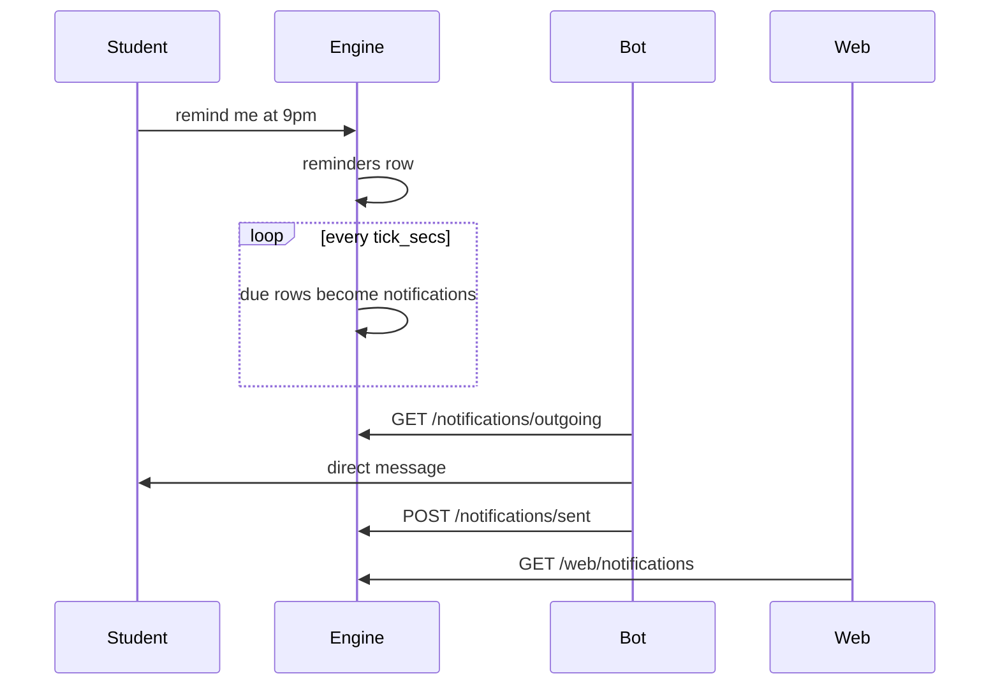

The bot polls `GET /notifications/outgoing` every `bot.notify_every_secs` with the service token, sends each as a direct message, and reports the ids with `POST /notifications/sent`; a student who does not accept direct messages is reported too, so nothing loops. The web reads `GET /web/notifications` for the unread dot, `POST /web/notifications/read` when home is shown, and `GET /web/reminders` and `DELETE /web/reminders/{id}` for Settings, Reminders, all with the session only.

## Linked accounts and integrations

Platform runs every per-user login and holds the grants. Canvas is the exception (see Canvas). `/login <service>` in Discord calls `POST /oauth/{provider}/authorize`, which returns the Platform login link the bot shows privately. The user signs in through the provider's own SSO; SparkyAI never sees a password. `/logout <service>` calls `POST /oauth/{provider}/logout`, which removes the Platform-linked grant. The web Settings page calls the same routes with its session, plus `GET /oauth/{provider}/status`. A provider whose tool (`[gcal]`, `[outlook]`) is off answers 503. `Credentials` in `runtime::tools::account::grant` reads a caller's token for a provider from Platform, which refreshes an expired one.

`runtime/tools/account/outlook` offers read-only Outlook tools over Microsoft Graph, off until `[outlook] enabled`: `outlook_calendar` and `outlook_mail`, both `ReadAuthenticated` and direct-message only, keyed to the `microsoft` provider. Reading ASU accounts needs ASU admin consent on the Platform Microsoft app.

`runtime/tools/account/gcal` offers a read-only `google_calendar` tool over the Google Calendar API, off until `[gcal] enabled`: it lists the caller's upcoming events, is `ReadAuthenticated` and direct-message only, and is keyed to the `google` provider. The Calendar REST client sits behind the `GoogleCalendar` trait in `core/traits/tools/gcal.rs`.

## Chat search

`settings` and `disconnect` (`runtime/tools/settings.rs`) let a student change their own setup by asking, so Sparky never sends them to a settings page. `settings` (`PrepareWrite`, private) shows check-in quiet hours, switched-off kinds and linked accounts, changes the first two, and hands out the Canvas steps or a provider sign-in link from `OAuthStore::login_link`. `disconnect` (`Destructive`, so the student approves it) removes the Canvas link or a provider grant. Both are on while `[settings] enabled`.

An unknown tool name gets back `ToolSet::unknown`: the offered names within an edit distance of 3 or sharing the name, else every offered name. A Platform search that fails on a broken connection or a 502 to 504 is sent once more when at least 5 seconds remain; if it fails again the model reads that the source could not be read right now and to search another way, never that it is unreachable.

`search_chats` (`runtime/tools/chats.rs`) finds what the student and Sparky said in earlier private chats. Migration 0007 keeps an FTS5 table, `messages_fts`, over the text of user and assistant messages; triggers add each new one and drop deleted ones, so tool results and summaries are never indexed. `ConversationStore::search` matches any of the query's words as prefixes, ranks by bm25, and returns at most `chat_search.max_hits` snippets from the caller's own private conversations, leaving out the one in progress. It is `ReadAuthenticated` and private, registered when `[chat_search] enabled` and `store.backend` is `sqlite`. Memories are what Sparky chose to keep; chat search is the rest.

## Home chat

Each student has one home conversation, id `home_id(tenant, user)` (a UUID v5), on channel `web`, private. When a reminder fires or a nudge is sent, the same transaction that writes the `notifications` row writes an assistant message to home with `notice: {id, kind}`, so the student sees it in the chat and the agent reads it as history when they reply. Writing there leaves `updated_at` alone, so only the student's own turns count as activity. A reset never ends home, and the conversation list leaves it out.

Home is never empty. `GET /web/home` writes `home.welcome` as Sparky's first message when home holds none, and the onboarding rule takes it from there (see Memory).

A thread is a web conversation started from one message: the first turn sends `parent: {conversation_id, position}` and `reply_to` with that message's text. `ConversationStore::link` keeps the parent only when both conversations are the student's and the message exists.

With `home.threads` on, a message the student sends in home goes through a short model call (`home.route_prompt`, a `Task`). THREAD keeps the message in home, opens a thread off it, and runs the turn there; the answer comes back with the thread's id, and the web follows it and links the thread under the question in home. HOME (a greeting, thanks, an answer to Sparky) runs the turn in home. A failed or slow call, or a message with attachments, stays in home.

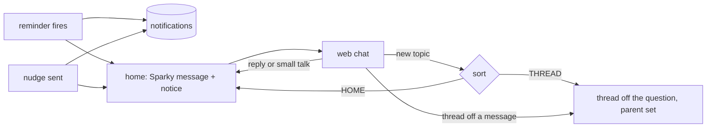

## Nudges

Nudges are notifications Sparky sends on its own. `runtime/nudge/` holds the loop; it reads only `core` traits. Every `nudges.tick_secs` it takes each student with a private conversation in the last `nudges.active_days` (`NudgeStore::people`, one row per user at their latest tenant), skips them in quiet time, and stops at `nudges.daily_cap` a local day.

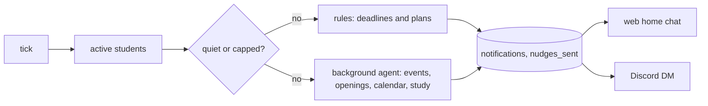

The rules (`runtime/nudge/rules.rs`) need no model call. They read the `upcoming` sources and the student's memories:

| Kind | When |
| --- | --- |
| `due_soon` | an item due within `due_soon_hours`, reminders left out |
| `new_item` | a Canvas item that was not there before; the first look only marks what is there |
| `start_early` | an item with a `big_work` word `start_early_days` out, in the daytime |
| `follow_up` | a task with no date said `follow_up_days` to `follow_up_max_days` ago |
| `brief` | weekday mornings from `brief_hour`, when something is due in `brief_days` |
| `week_plan` | Sunday from `week_plan_hour`, the week day by day |
| `after_due` | a `big_work` item 1 to `after_due_hours` hours after it was due, in the daytime |
| `exam_week` | once a week, when `exam_week_min` items with an `exam_words` word fall in the next 7 days |
| `wins` | Friday from `wins_hour`, when at least `wins_min` items were due since Monday |
| `tips` | one of `tips` a day, each once, in the first `tips_days` after the student's first chat |

`after_due`, `exam_week` and `wins` pick one of their `*_lines` by the nudge key, so the same nudge always reads the same and the next one reads differently. In an exam week, `event` and `opportunity` do not run.

`event`, `opportunity`, `calendar` and `study` run the agent through the `Background` trait: `Agent::background` is a copy with only `ReadPublic` and `ReadAuthenticated` tools, no conversation store and no confirmations, so nothing is kept or written. Each runs at most once a day (`calendar` and `opportunity` once a week, on `calendar_weekday` and `opportunity_weekday`) from its configured hour, and the instruction (`nudges.event_prompt`, `opportunity_prompt`, `calendar_prompt`, `study_prompt`) asks for `nudges.nothing` when nothing is worth saying. `event` and `opportunity` run only for a student Sparky knows something about. `opportunity` looks for internships, research positions and hackathons that fit them.

Care is not a nudge: `prompt.proactive_rules` asks Sparky to answer a stressed student warmly, name ASU Counseling once in that chat, and suggest rest late at night.

Every nudge carries keys in `nudges_sent`, so nothing is said twice; keys older than `nudges.keep_days` are dropped. A nudge is a `notifications` row with `kind` set, so home and the bot deliver it like a reminder. `GET` and `PUT /web/nudges` read and keep a student's quiet hours and switched off kinds; `POST /web/notifications/{id}/feedback` records whether a nudge was useful, and not useful switches its kind off.

`upcoming` (`runtime/tools/upcoming.rs`) lists what the caller has coming up in one call: remembered tasks, reminders, Canvas due dates, and Google and Outlook events, merged and sorted by date, at most `upcoming.max_items`, for the next `days` (default `upcoming.default_days`, at most `upcoming.max_days`). Each integration that has dated items adds an `UpcomingSource` (`core/traits/tools/upcoming.rs`) beside its tools; a source whose tool is in `tools.disabled` is left out, and the tool is registered only when `[upcoming] enabled` and at least one source is. The sources are read in parallel within the request deadline. A source that is not linked, fails, or runs out of time adds one line naming it. `upcoming` is `ReadAuthenticated` and `private`.

Three public, no-auth tools sit beside search: `search_papers` (Semantic Scholar), `wikipedia_lookup` (MediaWiki) and `read_page`. They are `ReadPublic`. `read_page` takes a URL and returns the page text; every hop must resolve to a public address on port 80 or 443, and the connection goes to the address that passed the check. With `read_page.save_pages` on, a page with text is sent to Platform as its URL only (`POST /api/knowledge/discovered`, `Discovery` trait, `stores/platform/discovery.rs`), in the background. Platform saves it as a crawled source and keeps it fresh, so the next search finds it in stored knowledge. `calculate` works out arithmetic and date math in the engine, with no network.

A stored `search` result shows when its page was fetched, and Platform adds a note when a page is old, which points the model to `read_page` for the current copy.

A turn stops gathering and answers from what it has once it reaches the last step, `agent.max_tool_calls`, or `agent.answer_reserve_secs` before the deadline. A step offered no tools never runs one.

A confirmation is bound to a hash of the exact arguments, belongs to the caller who was asked, is single use, and expires after `agent.confirmation_ttl_secs`. Its summary names the tool, the arguments, and whether the action can be undone. The policy decision is recorded in the trace.

## Search

`search(query, source?)` is Platform's tool (`asusoda/platform`, `modules/submodules/find.py`). At boot the engine reads its description and JSON schema from `GET /api/tools` and fails to boot if Platform does not offer it to the token. The model reads Platform's wording as is, so a new source on Platform reaches the model with no engine change. A call is `POST /api/tools/search` with the arguments the model sent, bounded by `query.timeout_secs` and the request deadline. Calls in one step run at the same time.

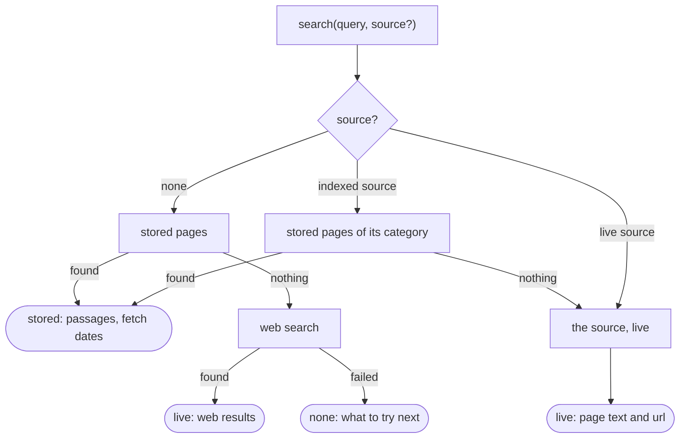

Platform turns the query into the parameters the source takes: a choice the query names, a date, a course code and term for the class search. A query missing a required detail is refused with what it has to say. A refusal reaches the model as `InvalidArguments`. The engine renders a stored answer with each page's url and fetch age, a live answer with its url, and cites each page in `Answer.sources`.

`clubs` and the Sun Devil Central half of `events` are read over the organization's ASU sign-in on Platform and are never indexed. Not covered: X and Instagram posts, and anything behind an individual student's login (Workday jobs, personal MyASU data), which waits on the per-user sessions of Phase 8.

## Discord surface

| Entry | Where the answer goes | Visibility |
|---|---|---|
| mention in a text channel | a thread opened from the message, or inline if the thread cannot be made | public |
| reply to a Sparky message in a thread | that thread | public |
| any other message in a thread | nowhere; the bot stays quiet | |
| direct message | the direct message channel | private |

A thread is the conversation. Inside one, only a reply to something Sparky said continues it. The message replied to rides the request as `reply_to` and is quoted into the prompt under `prompt.reply_header`, capped by `agent.reply_budget_tokens`. A reply to a person or another bot is not a turn.

A direct message is private: only there are memories recalled and the memory tools offered. `bot.direct_messages` turns the direct channel off.

Up to `bot.max_images` image attachments ride the request as image blocks on the user turn. The engine filters them again in `Attachment::accepted`. Only the link travels, the model server fetches it, and history stores none of them. Whether the model reads images depends on the model; see `deploy/inference/README.md`.

Reading a reply whose author turned its ping off needs the privileged Message Content intent, enabled on the application at discord.com/developers. Without it the reply goes unanswered.

A turn is one message, edited in place. It opens with a spinner header and gains one line per progress event. The engine writes each line's text; the bot never keeps its own copy of the event enum. A line with a `slot` overwrites the earlier line in that slot. A `clear` event removes a line. A `draft` event sets or withdraws the answer shown under the steps. Edits are paced to one per `bot.edit_every_ms`.

The finished card shows the steps (the oldest fold into a count when space runs out), the answer, the memories the prompt carried (`ChatResponse.memories`), and sources without a URL. Sources with a URL are link buttons. An answer that does not fit spills into further messages. An approval adds buttons to the card, and the resumed answer replaces the prompt on the same card.

A conversation belongs to one tenant, user, channel, and visibility. The bot holds no conversation state. `/reset` ends the caller's open conversations in the channel through `POST /conversation/reset`. `/memories` lists what Sparky remembers, numbered; `/forget <n>` removes one, and `/forget all` asks with buttons, then removes every memory.

## Storage

| Data | Store |
|---|---|
| conversations, messages, memories, confirmations | the engine SQLite file (`store.path`) and its backups |
| knowledge index, search sources, linked account grants | Platform |
| local traces, console logs, eval reports | `.sparky/`, ignored |

The engine keeps nothing else. Its schema is `apps/engine/migrations/`; the Platform schema lives in the Platform repo.

## Failure behavior

| Failure | Response |
|---|---|
| model returns a retryable error | retry with backoff up to `agent.max_model_retries` within the deadline, then 502 |
| all model slots busy past `agent.model_queue_wait_secs` | 503, which the bot reports as temporary |
| model call outlives the request deadline | run ends as `Deadline` |
| tool argument error or Platform refusal | the reason becomes the tool result and the model corrects the call |
| tool timeout | `ToolError::Timeout` fed back as the tool result |
| a search outlives `query.timeout_secs` or the deadline | `QueryError::Timeout` fed back as the tool result |
| model repeats an identical tool call | repeat refused, next step offers no tools, `Stalled` if it repeats again |
| thinking spends the whole completion | the call is made again without thinking |
| prompt would exceed the budget | history is trimmed and tool results are cut; boot checks keep tool schemas under half |
| `search` finds nothing | Platform's note sends the model to another wording, another source, or `read_page` |
| guardrail blocks a response | run ends as `Blocked` with `guardrail.replacement` |
| guardrail finds a protected term in an answer | the term is replaced with `guardrail.redaction` and the answer proceeds |
| confirmation denied, expired, or answered by someone else | nothing runs |
| Platform unavailable | the engine does not boot, the readiness probe fails, and a request that needs a store gets 503 |
| JSONL trace over `trace.max_file_bytes` | later events for that request are dropped |

## Tracing

Every request produces one trace covering model calls, tool calls, memory recall, policy decisions, guardrail blocks and redactions, and the outcome. The live pieces of a streaming call (reasoning so far, answer drafts, a withdrawn draft) go only to the watcher; the recorded trace keeps the finished call. A guardrail block or redaction is also recorded as an event on the `agent.run` span. Each `tool` span carries the tool's risk class.

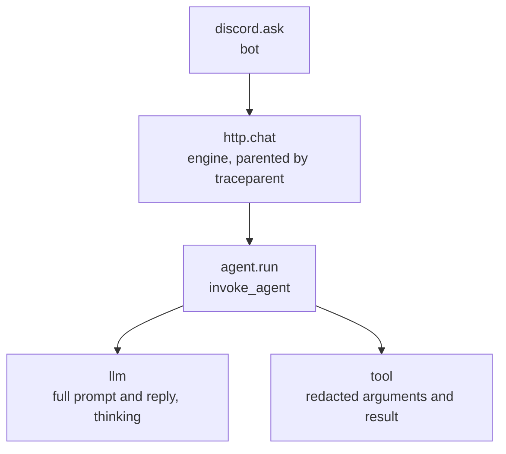

Traces go to two places:

- JSONL at `.sparky/traces/<request_id>.jsonl`: the complete local record of trace events.
- Phoenix: spans exported over OTLP/HTTP to `telemetry.phoenix_url` plus `/v1/traces`, read as a tree per conversation. They carry `gen_ai.*` attributes beside the OpenInference ones the Phoenix UI reads: `user.id` for the user, `session.id` for the conversation. The resource attribute `openinference.project.name` puts them in the project named by `telemetry.project_name`.

An empty `phoenix_url` turns export off. `telemetry.phoenix_api_key` is sent as a bearer token when set. The bot records each product event as one span under the interaction (`[analytics]`). A finished answer carries Helpful and Not helpful buttons; only the person who asked can press them, and a press records `discord_feedback` with the `request_id` of the answer and `helpful`, so Phoenix joins the rating to the engine trace.

Secrets, credentials, cookies, and sensitive form values are redacted from tool arguments and results before they reach any trace. The result of a `ReadAuthenticated` tool never reaches a trace in clear: the JSONL trace, the `tool` span and the prompt recorded on the `llm` span carry `[authenticated result, <n> chars]` in its place. The answer built from it stays in the trace. The developer console mirrors followed stdout into `.sparky/logs/<unit>.log`. Deployments keep stdout with the platform log driver.

## Metrics

`llama-server` runs with `--metrics` and exports Prometheus format on its own port. Prometheus scrapes it and Grafana reads Prometheus. Both are opt-in (`just metrics`) and bind to loopback.

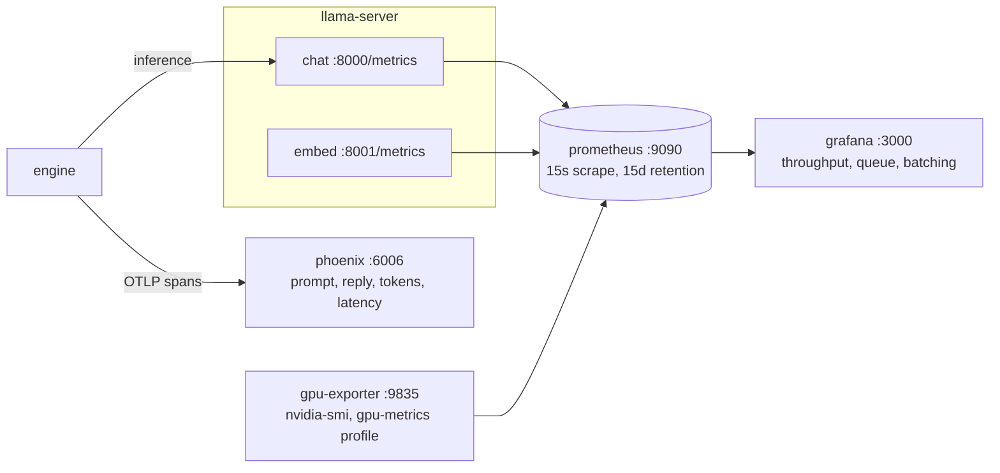

Phoenix holds spans and events; Prometheus holds time series. Dashboard panels and their metric names are in `deploy/README.md`.

## Authenticated tasks (Phase 8)

Not built; nothing drives a page on a user's behalf. A design must meet these rules: the user completes login and MFA themselves, SparkyAI never asks for or stores a password, authenticated page content is never indexed or memorized, and any consequential submission is confirmed by the user. This is per-user, each user's own session for their own data, and distinct from the organization ASU sign-in Platform uses for Sun Devil Central.

## Configuration

Two layers, lowest first: `sparky.toml`, then `SPARKY_<SECTION>__<KEY>` environment variables, which win. `sparky.toml` is committed and holds every tunable value. `.env` is not committed and holds only secrets, per-machine URLs, and what docker compose and the justfile read. The image copies `sparky.toml` in, and compose overrides the service URLs through the environment.

Rust reads the file with figment, `apps/evals` with tomllib through pydantic-settings. `SPARKY_CONFIG_FILE` points at a different file, such as an eval profile. A missing file is not an error.

Sections in `sparky.toml`: `app`, `agent` (with `agent.thinking`), `prompt`, `model` (with `model.sampling`), `policy`, `tools`, `sandbox`, `guardrail`, `compaction`, `query`, `mcp`, `outlook`, `gcal`, `canvas`, `upcoming`, `reminders`, `nudges`, `chat_search`, `calculate`, `read_page`, `papers`, `wikipedia`, `trace`, `telemetry`, `analytics`, `http`, `web`, `home`, `admin`, `bot`, `platform`, `store`, `memory`, `cli`, `evals`. The `engine` and `discord` sections hold only env values: the service token and the guild id; `platform.url` and `platform.token` come from the environment too.

A default belongs to exactly one settings struct; adapters declare no defaults of their own. `Config::validate` rejects at boot any combination the engine cannot serve, for example a section budget above the prompt budget, a sample ratio out of range, two MCP servers with the same name, a missing or malformed `SPARKY_PLATFORM__URL`, a missing `SPARKY_PLATFORM__TOKEN`, an empty `platform.mcp_private` or `platform.mcp_skip` prefix, a `[canvas]` window with `default_days` above `max_days`, a `[web]` sign-in without its Discord app, session key, https URLs, or its site in `http.cors_origins`, or with `agent.confirmation_ttl_secs` past what the platform accepts. An unreadable `prompt.system_file` also stops the boot. Nothing is clamped at runtime.

`prompt` holds the wording the harness writes around every section. `system_file` takes precedence over `system`, which takes precedence over the built-in prompt.

## Deployment

One service image, `sparkyai-rust` (engine and discord, selected by entrypoint). `sparkyai-sandbox` and `sparkyai-sandbox-proxy` are the images the engine starts for `run_sandbox`. `sparkyai-runpod` holds every service and both models for one RunPod pod, where containers cannot start, so `run_sandbox` runs as WebAssembly there. CD rebuilds only the images whose inputs changed. Platform runs outside this repo. `llama-server` runs as the compose services `chat` and `embed` under the `model` profile, configured in `deploy/inference`. Details are in `deploy/README.md`.

## Open decisions

- Chat model size and quantization.
- Whether a reranker earns its place once the eval set exists.
- Parallel slots per `llama-server` under load.
- Default `chars_per_token` once the tokenizer is measured.
- Retention periods for conversations and traces. `store.conversation_idle_days` is 0 (keep) until this is settled; #82 proposes 30.
- App server host.

Record each in the commit that settles it.
